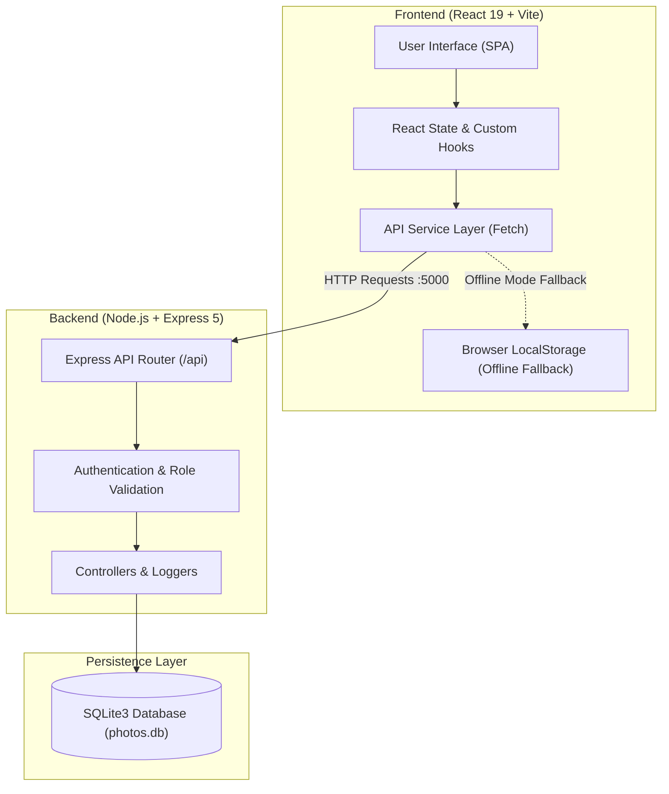
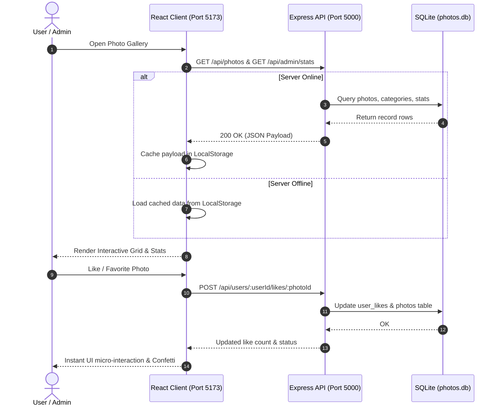

# 📸 Aether Photo Gallery

A modern, high-performance, full-stack Photo Gallery application built with **React 19**, **Vite**, **TypeScript**, **Tailored Vanilla CSS**, **Express 5**, and **SQLite3**.

Features a responsive masonry layout, full-screen lightbox with EXIF metadata, user authentication, personal favorites/likes, rich admin dashboard, and offline fallback resilience.

---

## 📑 Table of Contents
- [Architecture & Diagrams](#-architecture--diagrams)
  - [System Architecture](#system-architecture)
  - [Component Hierarchy](#component-hierarchy)
  - [User & Data Flow](#user--data-flow)
- [✨ Key Features](#-key-features)
- [🚀 Quick Start (How to Run)](#-quick-start-how-to-run)
  - [Prerequisites](#prerequisites)
  - [Installation](#installation)
  - [Running the Application](#running-the-application)
- [🔑 Demo Accounts](#-demo-accounts)
- [🛠️ Available Scripts](#️-available-scripts)
- [🌐 REST API Endpoints](#-rest-api-endpoints)
- [📁 Project Structure](#-project-structure)
- [💻 Tech Stack](#-tech-stack)

---

## 🏛️ Architecture & Diagrams

### System Architecture

The application adopts a decoupled client-server architecture with an automatic offline fallback to browser `localStorage` if the backend is unavailable.



---

### Component Hierarchy

A clean tree structure of components ensuring separation of concerns:

```mermaid
graph TD
    App["App Component (Root)"]
    Navbar["Navbar (Search, Theme, User Menu, Admin Link)"]
    StatsSummary["StatsSummary (Top Metric Cards)"]
    CategoryFilter["CategoryFilter (Category Tabs)"]
    FilterBar["FilterBar (Sorting, Orientations, Layout Toggle)"]
    PhotoGrid["PhotoGrid (Masonry / Flex Layout)"]
    PhotoCard["PhotoCard (Image, Likes, Author, Quick Actions)"]
    LightboxModal["LightboxModal (Full-screen view, EXIF, Navigation)"]
    PhotoDetailView["PhotoDetailView (Detailed Meta & Statistics)"]
    EditPhotoModal["EditPhotoModal (Edit Title, Tags, Category)"]
    PhotoUploadModal["PhotoUploadModal (Add New Photo with Preview)"]
    UserProfileModal["UserProfileModal (Favorites, Likes, Edit Profile)"]
    AuthModal["AuthModal (Login / Register Switcher)"]
    AdminDashboard["AdminDashboard (Metrics, Logs, User/Photo Mgmt)"]
    HTMLToJSXLab["HTMLToJSXLab (Developer Sandbox Utility)"]

    App --> Navbar
    App --> StatsSummary
    App --> CategoryFilter
    App --> FilterBar
    App --> PhotoGrid
    PhotoGrid --> PhotoCard
    App --> LightboxModal
    App --> PhotoDetailView
    App --> EditPhotoModal
    App --> PhotoUploadModal
    App --> UserProfileModal
    App --> AuthModal
    App --> AdminDashboard
    App --> HTMLToJSXLab
```



---

### User & Data Flow



---

## ✨ Key Features

- **Dynamic Gallery Grid**: Masonry-style layout, category tabs, tag filters, aspect ratio filtering, and multiple sorting options (Popularity, Recent, Views, Title).
- **Interactive Lightbox**: Full-screen photo inspection, keyboard navigation (left/right/escape), like counters, download trigger, and full camera EXIF metadata display (Camera Model, Lens, Focal Length, Aperture, Shutter Speed, ISO).
- **User Authentication & Personalization**: Register, login, manage favorites, track liked photos, and edit user profile.
- **Admin Control Center**:
  - Live system stats (Total Photos, Categories, Users, Views, Likes, DB size).
  - Activity audit logging.
  - User and photo management (CRUD actions).
  - Database re-seeding tool.
- **Upload & Edit**: Add new photos with immediate preview, edit metadata, and delete photos.
- **HTML-to-JSX Playground**: Built-in developer utility to paste raw HTML and convert it to clean JSX in real-time.
- **Offline Resilience**: Automatically falls back to local storage if the backend server is stopped.

---

## 🚀 Quick Start (How to Run)

### Prerequisites

Ensure you have the following installed on your system:
- **Node.js**: `v18.0.0` or higher ([Download Node.js](https://nodejs.org/))
- **npm**: `v9.0.0` or higher (comes with Node.js)

---

### Installation

1. **Clone the repository:**
   ```bash
   git clone https://github.com/souradip7679/photo-gallery.git
   cd photo-gallery
   ```

2. **Install dependencies:**
   ```bash
   npm install
   ```

---

### Running the Application

You can run both the frontend and backend together with a single command:

#### Option 1: Run Client & Server Concurrently (Recommended)

```bash
npm start
```
*or*
```bash
npm run dev
```

This launches:
- 🖥️ **Frontend Client**: [http://localhost:5173](http://localhost:5173)
- ⚙️ **Backend API**: [http://localhost:5000](http://localhost:5000) (auto-initializes SQLite database)

---

#### Option 2: Run Separately in Individual Terminals

If you want to view backend or frontend logs in separate terminals:

**Terminal 1 — Backend Server:**
```bash
npm run server
```
*Runs the Express API on port 5000 using `tsx watch` for auto-reloading.*

**Terminal 2 — Frontend Client:**
```bash
npm run dev:client
```
*Runs the Vite development server on port 5173.*

---

## 🔑 Demo Accounts

The database comes pre-seeded with two default accounts:

| Role | Username / Identifier | Email | Password | Access Privileges |
| :--- | :--- | :--- | :--- | :--- |
| **Admin** | `admin` | `admin@gallery.com` | `password123` | Full access (Admin Dashboard, user management, DB re-seed, upload/edit/delete) |
| **User** | `john_doe` | `user@gallery.com` | `user123` | Standard access (Browse, like, favorite, upload, edit profile) |

> 💡 *You can also create your own custom account via the **Sign Up** tab in the application.*

---

## 🛠️ Available Scripts

In the project root, you can run:

| Command | Description |
| :--- | :--- |
| `npm start` | Starts both server and Vite client concurrently |
| `npm run dev` | Alias for `npm start` |
| `npm run dev:client` | Starts only the Vite client development server |
| `npm run server` | Starts only the Express + SQLite backend with auto-reload |
| `npm run build` | Builds the TypeScript application and bundles production assets via Vite |
| `npm run preview` | Locally previews the production build output |
| `npm run lint` | Runs ESLint to check code quality |

---

## 🌐 REST API Endpoints

The backend exposes the following REST API under `http://localhost:5000/api`:

### System & Health
- `GET /api/health` — Backend status and database health check

### Authentication & Users
- `POST /api/auth/register` — Create a new account
- `POST /api/auth/login` — Authenticate user
- `GET /api/auth/users` — List all registered users (Admin)
- `PUT /api/auth/users/:id` — Update user profile
- `DELETE /api/auth/users/:id` — Delete user account (Admin)

### Photos
- `GET /api/photos` — Fetch all photos
- `POST /api/photos` — Upload/create new photo
- `PUT /api/photos/:id` — Update photo details
- `DELETE /api/photos/:id` — Delete photo
- `POST /api/photos/:id/like` — Toggle like count
- `POST /api/photos/:id/view` — Increment view counter

### Per-User Interactions
- `GET /api/users/:userId/favorites` — Get user's favorited photo IDs
- `POST /api/users/:userId/favorites/:photoId` — Toggle photo favorite status
- `GET /api/users/:userId/likes` — Get user's liked photo IDs
- `POST /api/users/:userId/likes/:photoId` — Toggle user like status

### Admin
- `GET /api/admin/stats` — System statistics (counts, views, storage)
- `GET /api/admin/logs` — Activity audit logs
- `POST /api/admin/seed` — Reset & re-seed database with mock data

---

## 📁 Project Structure

```
photo-gallery/
├── public/                 # Static assets & icons
├── server/                 # Express + SQLite Backend
│   ├── db.ts               # SQLite setup, tables, seeding, CRUD queries
│   ├── index.ts            # Express server routes & middleware
│   └── photos.db           # SQLite database file (auto-generated)
├── src/                    # Frontend React Application
│   ├── assets/             # Images & SVGs
│   ├── components/         # React Components
│   │   ├── AdminDashboard.tsx
│   │   ├── AuthModal.tsx
│   │   ├── CategoryFilter.tsx
│   │   ├── EditPhotoModal.tsx
│   │   ├── FilterBar.tsx
│   │   ├── HTMLToJSXLab.tsx
│   │   ├── LightboxModal.tsx
│   │   ├── Navbar.tsx
│   │   ├── PhotoCard.tsx
│   │   ├── PhotoDetailView.tsx
│   │   ├── PhotoGrid.tsx
│   │   ├── PhotoUploadModal.tsx
│   │   ├── StatsSummary.tsx
│   │   └── UserProfileModal.tsx
│   ├── data/               # Mock seed data
│   ├── hooks/              # Custom React hooks (useLocalStorage)
│   ├── services/           # Frontend API client (apiService)
│   ├── types.ts            # Shared TypeScript interfaces
│   ├── App.tsx             # Main container & state management
│   ├── main.tsx            # React DOM root entry point
│   └── index.css           # Design tokens, variables & styling
├── .gitignore              # Git ignore rules
├── package.json            # Scripts & dependencies
├── tsconfig.json           # TypeScript configuration
└── vite.config.ts          # Vite build configuration
```

---

## 💻 Tech Stack

- **Frontend**: [React 19](https://react.dev/), [TypeScript](https://www.typescriptlang.org/), [Vite](https://vitejs.dev/), [Lucide React](https://lucide.dev/), [Canvas Confetti](https://www.npmjs.com/package/canvas-confetti)
- **Backend**: [Node.js](https://nodejs.org/), [Express 5](https://expressjs.com/), [tsx](https://github.com/privatenumber/tsx), [CORS](https://www.npmjs.com/package/cors)
- **Database**: [SQLite3](https://www.sqlite.org/)
- **Tooling & Styling**: Pure Vanilla CSS design system, ESLint, Concurrently